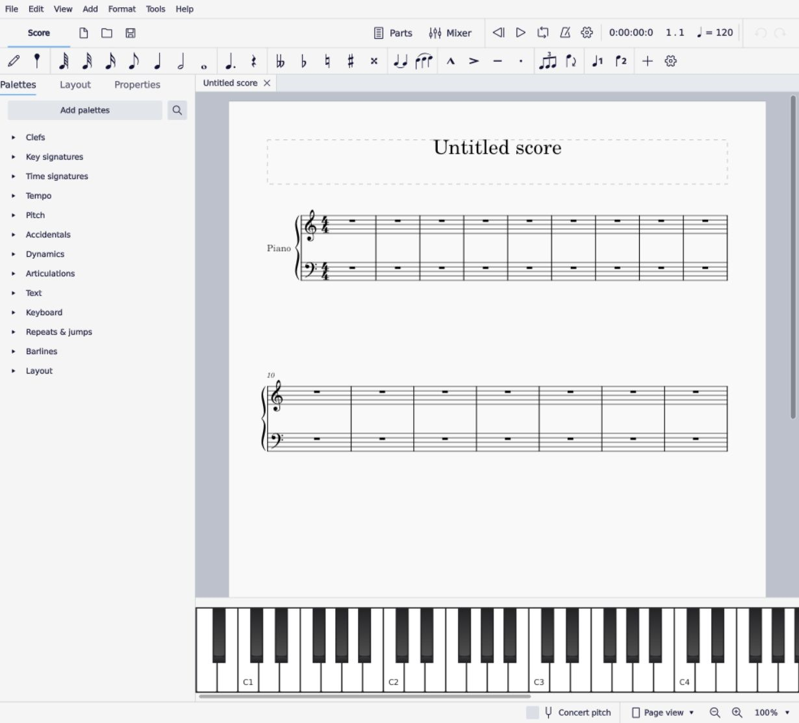

# Kết quả M0 — Pianist Web

Ngày kiểm chứng: 16/10/2026.

**M0 đạt mục tiêu chứng minh editor MuseScore chạy, sửa và lưu được trong trình duyệt.** Có thể tiếp tục kiến trúc React/TypeScript bao quanh engine Qt/WebAssembly. Đây chưa phải bản phát hành có đầy đủ chức năng MuseScore, thư viện project hoặc hai chế độ tập piano.

- Fork: [ntduyliem-source/pianist](https://github.com/ntduyliem-source/pianist), nhánh `pianist/m0-web`.
- Nền: MuseScore Studio `v4.7.5`, commit `3654226c2e99289916916953a98e585a3d3b315a`.
- Chạy tại máy phát triển: `http://127.0.0.1:8787/pianist.html`, sau khi bật server theo [runbook](M0_RUNBOOK.md).
- Bản đo: C++ Release, Qt 6.10.2 `wasm_singlethread`, Emscripten 4.0.7, liên kết app bằng `-FastLink`. Chưa nghiệm thu bản tối ưu phát hành hoặc hosting công khai.

## Nghiệm thu giao diện editor

Sau phản hồi về giao diện, M0 được hoàn thiện thêm shell editor theo bố cục MuseScore Studio. Trang bình thường mở thẳng bản piano trống 16 ô nhịp; không có header/nút/log thử nghiệm. Các thành phần NoteInputBar, NotationToolBar, PlaybackToolBar, UndoRedoToolBar, PalettesPanel, InspectorForm, LayoutPanel, MixerPanel, PianoKeyboardPanel, ZoomControl và ViewModeControl được dùng từ upstream. Sidebar và panel dưới có đường chia kéo để đổi kích thước; chưa có toàn bộ cơ chế floating dock của desktop.

File có New/Open/Save/Export, phím Ctrl+N/O/S/Shift+E, và hộp Save/Discard/Cancel khi thay project chưa lưu. Tên file và dấu sửa lấy từ project thật. Âm thanh được chuẩn bị trước, mở khóa bằng thao tác người dùng và điều khiển qua toolbar MuseScore. `/` và `/pianist.html` đều mở cùng editor. Công cụ kiểm chứng chỉ hiện khi có `?diagnostics=1`.

Đã kiểm tra trực tiếp trên trình duyệt trong ứng dụng bằng thao tác chuột/phím, mở/tải file thật, rồi đối chiếu MusicXML bằng parser Python độc lập:

- File → Open MXL và MusicXML; sửa cao độ một bán cung; undo/redo; Save MSCZ; Export MXL; mở lại cả hai giữ đúng nội dung.
- Đổi trường độ, xóa các nốt cũ, nhập hai nốt C/D bằng N/5/C/D và mở lại MSCZ giữ hai nốt mới.
- File ZIP/XML lỗi bị từ chối; project giữ nguyên và vẫn xuất được dữ liệu sau lỗi.
- Sửa Visible trong Properties; thêm staccato từ palette; xác nhận trong MusicXML và hoàn tác.
- Save/Discard/Cancel trước New/Open; mở Parts; Page settings đổi Landscape và xác nhận chiều trang trong MusicXML.
- Mở Mixer và bàn phím; Play chạy cursor và có mức tín hiệu trên Mixer; tăng zoom, chuyển Continuous view và thay đổi kích thước cửa sổ.

Bằng chứng mới ở `artifacts/m0/shell` và `docs/m0-evidence/shell-*`. Các JSON 12 ca trên Chrome/Edge dưới đây là baseline của commit `d005272d`, trước khi thay shell. Script browser đã được cập nhật cho shell mới và kiểm tra cú pháp; lượt hoàn thiện này dùng kiểm tra tương tác trong trình duyệt và file tải xuống, không ghi nhận là đã chạy lại script headless trên Chrome/Edge.

## Bằng chứng nghiệm thu

`tests/browser/pianist/m0-smoke.cjs` thực hiện 12 kiểm tra trên editor thật. Dữ liệu xuất được đọc bằng Python/XML độc lập với bridge JavaScript. Không dùng engine giả hoặc chỉ kiểm tra thông báo thành công.

| # | Kiểm tra | Kết quả |
| --- | --- | --- |
| 1 | WASM khởi động, canvas editor xuất hiện | Đạt |
| 2 | Nhập MXL và MusicXML thường giữ cao độ, onset, trường độ, dấu lặng, hợp âm và hai khuông của fixture | Đạt |
| 3 | Lệnh tăng cao độ thay đổi từng nốt đúng một bán cung, giữ nhịp và khuông | Đạt |
| 4 | Undo/redo trả lại đúng dữ liệu trước/sau sửa | Đạt |
| 5 | Tải MSCZ rồi mở lại giữ thay đổi | Đạt |
| 6 | Xuất MXL rồi nhập lại giữ thay đổi | Đạt |
| 7 | MXL không phải ZIP bị từ chối, project đang sửa được giữ | Đạt |
| 8 | XML hỏng bị từ chối, runtime không abort và project được giữ | Đạt |
| 9 | Chọn trong canvas, Ctrl+A, ArrowUp và Ctrl+Z sửa/hoàn tác thật | Đạt |
| 10 | Phím `4` đổi nốt đen thành móc đơn, undo phục hồi | Đạt |
| 11 | Delete xóa các nốt được chọn | Đạt |
| 12 | N, 5, C, D nhập hai nốt đen; tải MSCZ/mở lại giữ hai nốt mới | Đạt |

Trình duyệt đích được chạy bằng Playwright headless với SwiftShader trên Windows: Chrome `154.0.8037.17` và Edge `155.0.4283.45`. Chromium của Playwright `151.0.7922.34` cũng đã được dùng khi kiểm chứng port. Đây chưa phải thử nghiệm GPU, hệ điều hành hoặc trình duyệt di động đại diện cho người dùng cuối.

Corpus hiện có **một bài tự tạo CC0, hai ô nhịp, hai khuông piano, 10 nốt và một dấu lặng**; có hợp âm tay trái, dấu accent và tiêu đề tiếng Việt. Parser đối chiếu nội dung nốt theo ô nhịp/onset/duration/staff/MIDI, chưa so sánh mọi thuộc tính MusicXML hoặc độ giống layout của mọi phần mềm.

Bằng chứng cục bộ: `artifacts/m0/chrome`, `artifacts/m0/msedge`, `artifacts/m0/panels-*`. Có file MusicXML trước/sau từng thao tác, MSCZ/MXL tải xuống, screenshot, console và JSON. Bản tóm tắt nhỏ được lưu trong [m0-evidence](m0-evidence/) để xem trên Git; không đưa SDK hoặc binary WASM lớn vào repo.

## Ma trận editor đã khảo sát

| Nhóm | Trạng thái thực tế | Phạm vi/việc còn thiếu |
| --- | --- | --- |
| Nhập MXL/MusicXML, mở MSCZ | Đạt luồng M0 | Bridge nhận đúng đuôi file, giới hạn 32 MiB đầu vào; chưa có ngân sách tài nguyên giải nén |
| Thêm, sửa, xóa nốt và trường độ | Đạt các ca trên | Chưa nghiệm thu toàn bộ voice, tuplets, cross-staff và các loại ký hiệu |
| Undo/redo, lưu/mở lại, xuất MXL | Đạt | M0 tải file xuống; chưa có IndexedDB/autosave/recovery |
| Properties/Inspector | Đạt một thao tác | Ẩn nốt, xuất thành notehead/stem `none`, undo phục hồi; chưa thử toàn bộ thuộc tính |
| Palette | Đạt một thao tác | Double-click staccato, xác nhận trong MusicXML và undo; chưa thử toàn bộ palette/drag/drop |
| Layout panel | Hiển thị và chọn panel được | Thấy nhạc cụ Piano; chưa nghiệm thu thêm/bớt/đổi nhạc cụ hoặc part |
| Selection, phím nhập nốt, font | Đạt các ca trên | Tiêu đề tiếng Việt và glyph ký âm hiển thị đúng ở fixture; IME/accessibility chưa thử |
| Clipboard | Đạt Ctrl+C/Ctrl+V trên Chrome và Edge được cấp quyền | Chromium 151 trong bộ test không phát lệnh Ctrl+V; **Edit → Paste** vẫn thay nốt đúng. Cần thử permission prompt và clipboard bên ngoài app |
| Zoom | Nút zoom, menu Page/Continuous và Ctrl+wheel hoạt động | Wheel delta lớn có thể phóng quá mức; cần chuẩn hóa và thử chuột/trackpad thật |
| Audio | Baseline PCM khác 0 tại 48 kHz trên Chrome/Edge; shell mới có Play/cursor/Mixer meter | Shell chuẩn bị engine và mở khóa bằng thao tác người dùng; chưa đo độ trễ, dropout, loa/đàn thật hoặc độ chính xác BPM |
| Dialog/file menu | Đạt các luồng đã thử | Menu File web, hộp Export và Save/Discard/Cancel; dialog MuseScore Parts và Page settings mở được. Các dialog khác còn cần kiểm tra; không coi mọi menu upstream đều dùng được |
| MIDI, luyện Đúng nốt/Theo BPM | Chưa triển khai trong M0 | Giữ trong lộ trình M3–M5; không suy ra từ việc editor/audio chạy được |

`m0-panels.cjs` là khảo sát bổ sung: tự xác nhận sửa Properties, palette, nội dung paste và PCM; screenshot hỗ trợ xem layout/zoom/settings. Exit code của khảo sát chỉ phản ánh lỗi runtime/top-level; phải đọc từng cờ `passed`, đặc biệt clipboard. Test core trả mã lỗi nếu bất kỳ kiểm tra cốt lõi thất bại.

Audio được kiểm tra bằng AnalyserNode nối quan sát đầu ra thực của worklet, không bơm sóng hoặc thay synth. Lượt cuối ghi peak 0.07024 trên Chrome và 0.03830 trên Edge; peak chỉ xác nhận có tín hiệu, không dùng để so chất lượng hai browser. Đã thử mở nhiều project trước khi bật audio để tái hiện và sửa phản hồi bất đồng bộ trỏ tới player cũ. Không dùng kết quả này thay cho kiểm thử latency/MIDI của phần luyện.

## Tải và bộ nhớ

Số đo baseline từ commit `d005272d` trước khi hoàn thiện shell, server loopback không nén và context trình duyệt mới, trên máy phát triển khoảng 48 GB RAM. Đây là số đo phát triển, không phải SLA hoặc benchmark máy phổ thông; chưa đo lại heap sau khi mở các panel/dialog mới.

| Tài nguyên | Bytes | Xấp xỉ |
| --- | ---: | ---: |
| `MuseScoreStudio.wasm` | 133,709,138 | 127.51 MiB |
| `MuseScoreStudio.js` | 510,600 | 0.49 MiB |
| `MuseAudio.js` gồm WASM audio | 2,108,283 | 2.01 MiB |
| `MS Basic.sf3` | 51,278,610 | 48.90 MiB |
| Tổng bốn tài nguyên chính | 187,606,631 | 178.92 MiB |

Lượt core cuối: **Chrome 5.316 giây, Edge 5.682 giây** để editor sẵn sàng. Heap WASM chính lần lượt **524,943,360 và 524,877,824 bytes (~500.6 MiB)** sau luồng sửa/lưu; JS heap được báo 66,723,691 và 66,704,253 bytes. Đây là một lượt đo mỗi browser, không phải phân vị latency. `performance.memory` chỉ là ước lượng JS heap; heap WASM là vùng nhớ tuyến tính đã cấp phát, không tương đương RAM resident hoặc toàn bộ bộ nhớ của browser/audio/GPU. Chưa đo RSS, mạng WAN, heap audio đầy đủ hoặc score lớn.

M0 hiện tải soundfont sớm; cần tải theo nhu cầu. `-FastLink` giữ tên hàm để chẩn đoán và bỏ tối ưu Binaryen ở bước link. Không dùng kích thước này để kết luận giới hạn nhỏ nhất của sản phẩm. Muốn chốt hosting và hiệu năng phải build tối ưu, nén HTTP, đo cache lạnh/ấm và thiết bị có ít RAM.

## Những thay đổi giúp vượt M0

- Khôi phục build web theo CMake hiện tại; sửa phát hiện Emscripten trên Windows, export heap/API và các chỗ gọi tính năng Qt không có trong WASM.
- Loại bỏ interface web trùng tên nhưng khác ABI với shell desktop; chọn đúng lớp AppShell khi khởi tạo. Sửa đường QML, opacity cửa sổ và model menu theo Qt hiện tại.
- Định tuyến lệnh sửa/undo của MuseScore, đưa focus từ HTML về cửa sổ Qt mà vẫn giữ được input của Qt.
- Mở file theo định dạng, chỉ đổi project sau import thành công; bổ sung tải MSCZ và xuất MusicXML/MXL bằng writer thật.
- Từ chối MusicXML cần dialog phục hồi đồng bộ trên web thay vì abort runtime. Đây là chính sách tạm nghiêm ngặt: file desktop có thể mở một phần sẽ có thể bị từ chối ở M0.
- Port driver/audio engine, xử lý callback player hết vòng đời và bỏ sequence cho project cũ; xử lý hàng đợi callback của worklet. PCM đã được quan sát trong browser.
- Bổ sung script setup/build/serve, khóa công cụ, fixture và nghiệm thu browser. Native desktop build chưa được chạy trong lượt này; các thay đổi ở mã dùng chung vẫn cần CI native trước khi gửi upstream.

## Quyết định và công port còn lại

**Tiếp tục nền MuseScore WASM cho editor.** Giữ model, undo và import/export trong engine; M1 bổ sung shell TypeScript, bridge theo revision và lưu project. Chưa có căn cứ bỏ hướng fork hoặc thay editor bằng viewer.

Ngân sách tham khảo cho phần port còn thiếu, với một lập trình viên quen C++/Qt/WASM và web, chưa tính M1 hoặc bộ chấm/MIDI. Đây là khoảng dự trù từ phạm vi đã quan sát, không phải cam kết lịch:

| Công việc | Ước lượng công | Điều kiện nghiệm thu tiếp |
| --- | ---: | --- |
| Clipboard, focus menu/dialog và file workflows | 3–5 ngày công | Shortcut/menu thống nhất, hủy dialog không treo/crash/mất project |
| Bản build phát hành, tải theo nhu cầu, cache và đo bộ nhớ | 4–7 ngày công | Có baseline trên máy phổ thông và mạng giới hạn; không trộn phiên bản JS/WASM |
| Corpus và port phần editor còn thiếu | 10–20 ngày công | Các nhóm M2 có score kiểm chứng, gồm nhiều voice, tuplets, repeats, parts và layout |
| Ổn định audio và vòng đời tab/thiết bị | 3–6 ngày công | Đổi bài, ẩn tab, suspend/resume, loop không crash/dropout; đo latency riêng |

Tổng dự trù phần port: **20–38 ngày công**, có thể tăng nếu corpus phát hiện thêm phụ thuộc desktop. Trước khi phát hành cần xử lý các cảnh báo còn thấy trong console (action desktop chưa đăng ký, popup WebGL context, audio source fallback) và thử trên GPU/thiết bị thật. Chúng không làm thất bại 12 ca core nhưng chưa phải dấu hiệu một bản production đã ổn định.

Không triển khai hai mode luyện, thuật toán chấm BPM, tài khoản hay publish website trong M0. Các việc đó tiếp tục theo [kế hoạch dự án](IMPLEMENTATION_PLAN.md).
